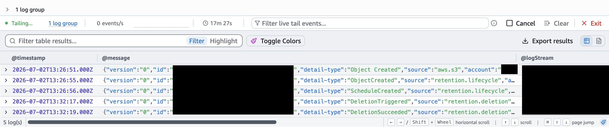
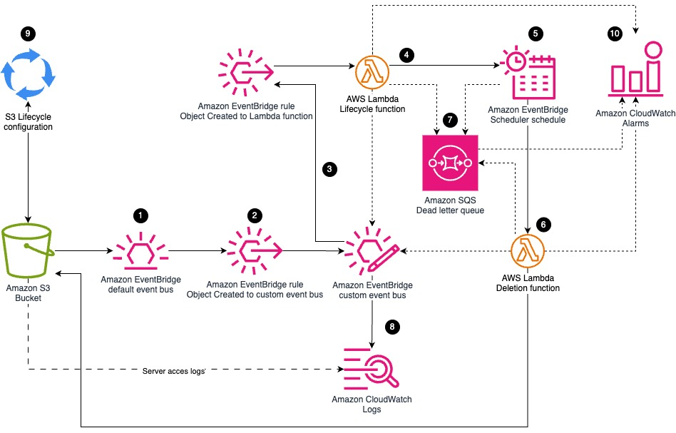

# Sample: S3 minute-level scheduled object deletion

This sample demonstrates a pattern that is designed to delete objects on S3 after a given time to live (TTL) of the order of minutes. The deletion is triggered with a one-time [EventBridge Scheduler schedule](https://docs.aws.amazon.com/scheduler/latest/UserGuide/what-is-scheduler.html). While S3 lifecycle rules also can be used to expire objects after a certain duration, the following deletion is asynchronous and [there might be a delay](https://docs.aws.amazon.com/AmazonS3/latest/userguide/how-to-set-lifecycle-configuration-intro.html#lifecycle-considerations) until the object is actually deleted.

Please note that this sample solution and code are only for testing and non-production purposes.

## Repository structure

```text
app.py                                  CDK app entry point
sample_s3_scheduled_deletion/
  stack/
    main_stack.py                       Stack: buckets + S3DataDeletion construct
    config.py                           Sample configuration file (edit this)
    constructs/deletion.py              Construct for deletion resources
    custom_resources/lambda_function.py Customized Lambda construct
  lambda/
    lifecycle_function/                 Schedules deletions on object creation
    deletion_function/                  Performs deletions
tests/                                  Stack and validation tests
```

Configure values in `sample_s3_scheduled_deletion/stack/config.py` to adapt the sample, for instance modifying the TTL parameters.

## Deployment

### Prerequisites

- An AWS account, already [bootstrapped for the AWS CDK](https://docs.aws.amazon.com/cdk/v2/guide/bootstrapping.html).
- Python (version 3.14 or later).
- [uv](https://docs.astral.sh/uv/getting-started/installation/) installed, for dependency management.
- The [AWS CDK](https://docs.aws.amazon.com/cdk/v2/guide/getting-started.html) installed (version 2.1139.0 or later).
- The [AWS CLI](https://docs.aws.amazon.com/cli/latest/userguide/getting-started-install.html) installed (version 2.32.12 or later).
- AWS credentials with sufficient permissions to deploy the solution.

### Install dependencies

This project uses [uv](https://docs.astral.sh/uv/) for dependency management.
Install the runtime dependencies into a virtual environment with:

```bash
uv sync
```

`uv sync` creates and manages `.venv` automatically. Prefix commands with `uv run` (e.g. `uv run cdk synth`) to execute them inside that environment, or activate it manually with `source .venv/bin/activate` (`.venv\Scripts\activate.bat` on Windows).

### Deploy the stack

Verify that you have available credentials with sufficient permissions to deploy in the expected AWS account:

```bash
aws sts get-caller-identity
```

Deploy with the AWS CDK, providing target account ID and region for deployment:

```bash
uv run cdk synth -c account=111122223333 -c region=aa-example-1
uv run cdk deploy -c account=111122223333 -c region=aa-example-1
```

replacing `111122223333` and `aa-example-1` with the desired Account ID and deployment region, respectively. Account ID and region are required parameters.

## Testing the solution

After deploying the solution, complete the following steps to test the functionalities of the solution.

### Open log trails

Open the log trails to see in real-time the lifecycle events of the object you just uploaded:
1. Log in to the [AWS Management Console](https://console.aws.amazon.com/).
2. Open the [CloudWatch console](https://console.aws.amazon.com/cloudwatch/home). Make sure to [choose the same AWS Region](https://docs.aws.amazon.com/awsconsolehelpdocs/latest/gsg/select-region-procedure.html) as the Region where you previously deployed the solution.
3. In the navigation pane, choose Logs / Log Management.
4. Choose the log group `/aws/events/sample-s3-scheduled-deletion-deletion-events`.
5. Choose `Start tailing`

### Open CloudShell

You can test the solution using [AWS CloudShell](https://aws.amazon.com/cloudshell/), which provides a pre-authenticated browser-based shell environment with the AWS CLI pre-installed.

1. Open the AWS console in a new browser tab or window.
2. Make sure to choose the same region as the Region where you previously deployed the solution.
3. Choose the CloudShell icon (terminal icon) in the navigation bar.
4. Wait for the shell to initialize.

### Test scheduled deletion

Enter the following commands in the CloudShell terminal to upload a test file:
```bash
# The deployed bucket name carries a hash suffix and is published as a stack
# output (also printed at the end of `cdk deploy` and shown in the
# CloudFormation console "Outputs" tab). Fetch it into a variable:
BUCKET_NAME=$(aws cloudformation describe-stacks \
  --stack-name SampleS3ScheduledDeletionStack \
  --query "Stacks[0].Outputs[?OutputKey=='DataBucketName'].OutputValue" \
  --output text)

# Upload test objects
echo "version 1" > test.txt
aws s3 cp test.txt s3://$BUCKET_NAME/retention-5-mins/test.txt

echo "version 2" > test.txt
aws s3 cp test.txt s3://$BUCKET_NAME/retention-5-mins/test.txt

# Confirm both versions exist
aws s3api list-object-versions --bucket $BUCKET_NAME \
  --prefix retention-5-mins/test.txt \
  --query "Versions[].{Key:Key,VersionId:VersionId,IsLatest:IsLatest}"
```

Following is an example of the expected response:
```json
[
  {
      "Key": "retention-5-mins/test.txt",
      "VersionId": "...",
      "IsLatest": true
  },
  {
      "Key": "retention-5-mins/test.txt",
      "VersionId": "...",
      "IsLatest": false
  }
]
```
With the default configuration, the solution schedules its deleteion 5 minutes after creation [with 60 second precision](https://docs.aws.amazon.com/scheduler/latest/UserGuide/schedule-types.html).

Enter the following commands in the CloudShell terminal to verify the deletion schedule has been created:
```bash
aws scheduler list-schedules \
  --group-name sample-s3-scheduled-deletion-deletion-schedules
```

Following is an example of the expected response:
```json
{
  ...
  "Name": "sample-s3-scheduled-deletion-...",
  "State": "ENABLED",
  "Target": {
    "Arn": "arn:aws:lambda:aa-example-1:111122223333:function:sample-s3-scheduled-deletion-deletion-fn"
  }
}
```

Go to the CloudWatch log trails you previously opened. Following is an example of what you should see:



After observing the `DeletionSucceeded` event in the logs, enter the following command in the CloudShell terminal to verify that both the schedule and object have been deleted:
```bash
aws scheduler list-schedules \
  --group-name sample-s3-scheduled-deletion-deletion-schedules
aws s3api list-object-versions --bucket $BUCKET_NAME \
  --prefix retention-5-mins/test.txt
```
The expected responses should contain empty lists for the schedules and the object versions.

### Test deletion with custom TTL

To test the optional override, set an `expireAt` ISO 8601 UTC timestamp as user
metadata at upload time.

Enter the following command in the CloudShell terminal to create an object with a custom expiration of at least two minutes in the future:
```bash
aws s3 cp test.txt s3://$BUCKET_NAME/retention-5-mins/test.txt \
  --metadata expireAt=YYYY-MM-DDTHH:MM:SSZ
```

### Test upload to disallowed prefixes

Enter the following command in the CloudShell terminal to test the upload to a prefix not matching the expected rules:
```bash
aws s3 cp test.txt s3://$BUCKET_NAME/not-allowed/test.txt
```

Following is an example of the expected response:
```
upload failed: ./test.txt to s3:// [...] An error occurred (AccessDenied) when calling the PutObject operation: User: [...] is not authorized to perform: s3:PutObject on resource: [...] with an explicit deny in a resource-based policy
```

## Troubleshooting

1. **S3 bucket name conflict** — If deployment fails because S3 bucket names must be globally unique, change `PROJECT_PREFIX` in `sample_s3_scheduled_deletion/stack/config.py` to a prefix of your choice. The bucket name is derived deterministically from that prefix, so choose a unique prefix to obtain a unique bucket name.

2. **Issues with `cdk synth` or `cdk deploy`** — In case of errors synthesizing the stack, check that you have the correct [prerequisites](#prerequisites). Check also that the expected versions of Python and other commands are running in your terminal.

3. **Objects not uploaded or deletion not scheduled** — Verify the object was uploaded to an allowed path prefix (for instance, `retention-5-mins/`). Also check that the `expireAt` metadata (if used) is in a valid format and set in the future. Check the CloudWatch log group of the lifecycle lambda function and check for logged errors for more information.

4. **Objects created with `expireAt` metadata are not deleted when expected** — Set the `expireAt` timestamp at least two minutes in the future. A timestamp closer than that is clamped to two minutes from now, and one that is in the past or cannot be parsed is ignored in favour of the rule's default TTL.

5. **Stack deletion fails due to non-empty bucket** — The bucket has a `DESTROY` removal policy but CDK does not empty buckets automatically. Manually [empty the bucket](https://docs.aws.amazon.com/AmazonS3/latest/userguide/empty-bucket.html) before retrying the stack deletion.

## Clean up

To clean up your resources, open the [AWS CloudFormation console](https://console.aws.amazon.com/cloudformation) and delete the stack `SampleS3ScheduledDeletionStack`.

Alternatively, you can also run `cdk destroy` from the same terminal where you ran `cdk deploy` and using the same AWS CDK CLI arguments as during deployment.

Remember to [empty the stack's S3 buckets](https://docs.aws.amazon.com/AmazonS3/latest/userguide/empty-bucket.html) before deleting the CloudFormation stack.

## Solution overview



1. An object is created in the S3 bucket. A bucket policy denies uploads outside the allowed prefixes, which is the first layer of enforcement. The bucket has Amazon EventBridge notifications enabled, so Amazon S3 emits an `Object Created` event to the account default EventBridge bus.
2. An EventBridge rule routes S3 `Object Created` and `Object Deleted` events from the default bus to a custom EventBridge bus dedicated to tracking lifecycle and deletion events. Forwarding `Object Deleted` too is what makes the actual removals visible in the consolidated log group (step 8).
3. Another EventBridge rule routes the event in the custom bus to the Lifecycle Lambda function.
4. The Lifecycle function matches the object key against the configured TTL rules. If no rule matches, the object is deleted immediately; this is a second layer of enforcement behind the bucket policy of step 1, and it only comes into play if the two ever disagree. Otherwise, the function reads the object's optional `expireAt` user metadata to determine the scheduled time of deletion. If `expireAt` is missing, cannot be parsed, or is in the past, `now + TTL` is used instead. Then, it creates a one-time schedule in the EventBridge custom Scheduler group.
5. When the schedule triggers, EventBridge Scheduler invokes the Deletion Lambda passing the S3 bucket, key, and version ID (when versioning is enabled) to delete. The schedule is [automatically deleted after completion](https://docs.aws.amazon.com/scheduler/latest/UserGuide/managing-schedule-delete.html#managing-schedule-automatic-deletion) to clean up unused resources and avoid saturating the [quota of schedules](https://docs.aws.amazon.com/scheduler/latest/UserGuide/scheduler-quotas.html).
6. The Deletion Lambda function permanently deletes the object version (using `VersionId` on versioned buckets, or a simple key-based delete on non-versioned buckets) and emits metrics and events.
7. Failed asynchronous invocations of either Lambda function are routed to a shared dead-letter queue (DLQ). A retry mechanism is configured for failed Lambda function invocations.
8. A rule on the custom bus matches application events and routes them to a single CloudWatch log group for a consolidated recording of all deletion activity.
9. The S3 bucket also has a lifecycle expiration rule as a fallback in case a schedule never fires. Because the bucket is versioned, the rule expires both current and noncurrent versions.

## High level considerations

- This sample solution is designed to support both versioned and non-versioned S3 buckets. When versioning is enabled, the deletion procedure specifies the `VersionId` in the delete call.
- The minimum TTL allowed for an object is two minutes. This is to allow some margin compared to the [60 second precision](https://docs.aws.amazon.com/scheduler/latest/UserGuide/schedule-types.html) of EventBridge Scheduler. Shorter TTLs are disallowed at stack synthesis time and the Lifecycle function clamps any earlier `expireAt` to the two-minute floor.
- Schedule names are derived deterministically from the bucket, key and, on a versioned bucket, the version ID. `CreateSchedule` is not an upsert, so if EventBridge redelivers an `Object Created` event while the first schedule is still pending, the second attempt raises `ConflictException`. The Lifecycle function treats that as success, logs an Info message and leaves the pending schedule in place, because it already deletes the same object.
- The Lambda functions run on the `python3.14` managed runtime and get `aws-lambda-powertools` and `pydantic` from the AWS-managed Powertools layer, whose ARN is resolved from SSM Parameter Store at deploy time. Nothing is bundled with the function code, so the local development dependencies exist only to run the tests against the same libraries.

## Development

Install the developer tooling (nox drives the test and quality sessions, and
each session installs its own dependencies via uv):

```bash
uv sync --group dev
```

The test suites are run through nox:

```bash
uv run nox -s tests_stack           # CDK synthesis tests (tests/stack/)
uv run nox -s run_lambda_fn_tests   # Lambda handler tests (tests/lambda/)
```

`tests/stack/` validates the retention-rule validation logic (rejecting empty
or non-`/`-terminated prefixes, TTLs below the two-minute minimum, TTLs that
exceed the lifecycle backstop, and duplicate prefixes) and the resources in the
synthesized CloudFormation template. `tests/lambda/` validates the Lambda
handlers.

You can also run the formatter and security scanners with nox:

```bash
uv run nox -s format     # black + isort
uv run nox -s security   # bandit
```

## Security

See [CONTRIBUTING](CONTRIBUTING.md#security-issue-notifications) for more information.

## License

This library is licensed under the MIT-0 License. See the LICENSE file.
